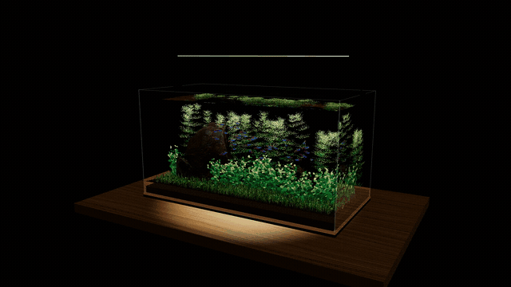
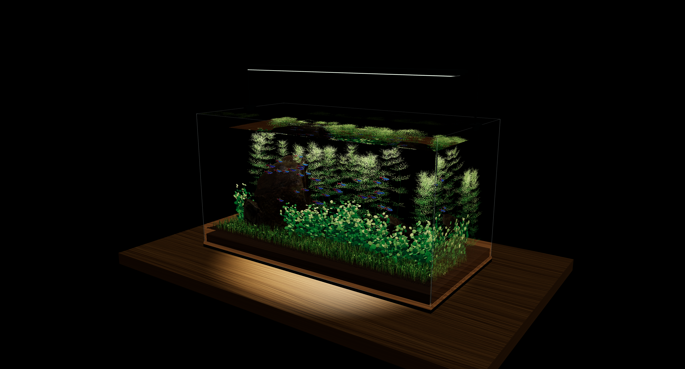
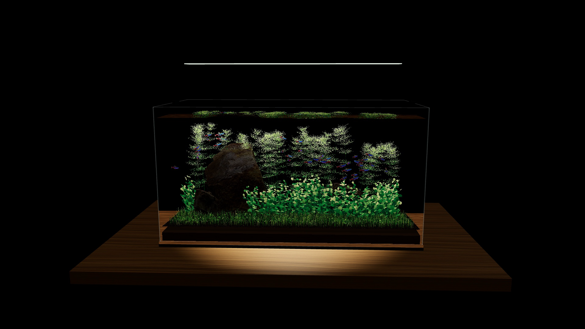
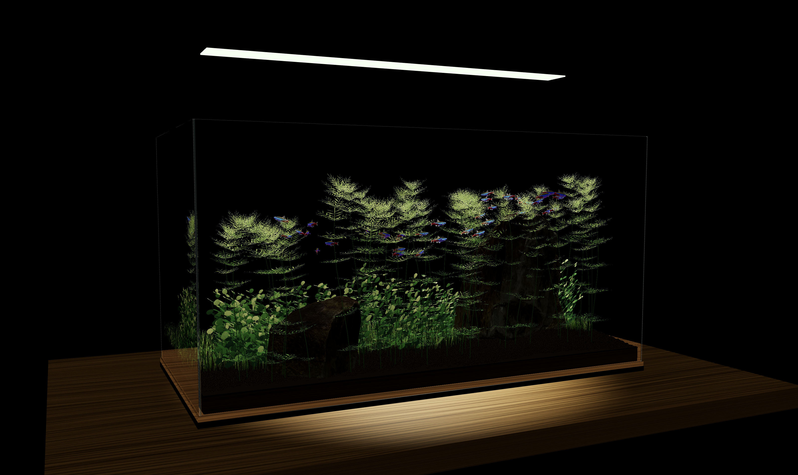
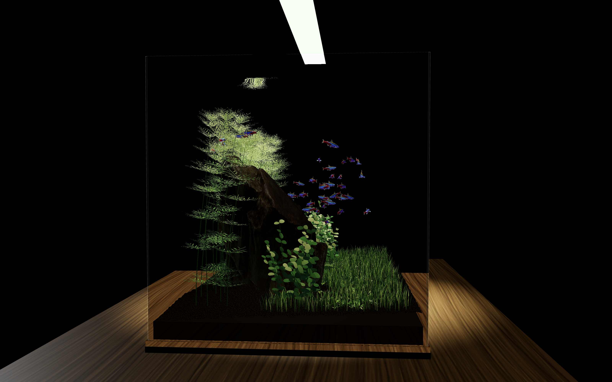
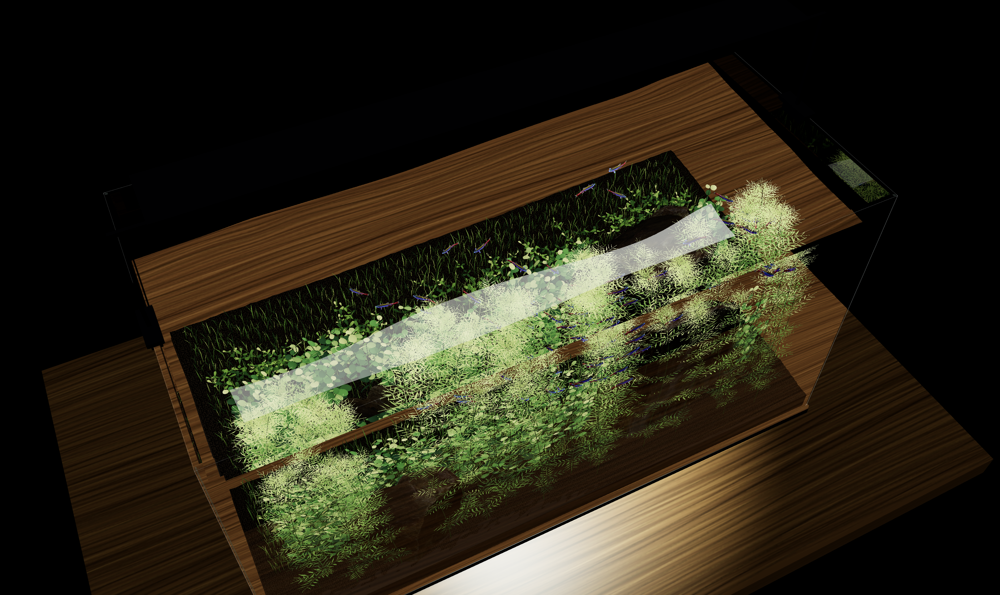
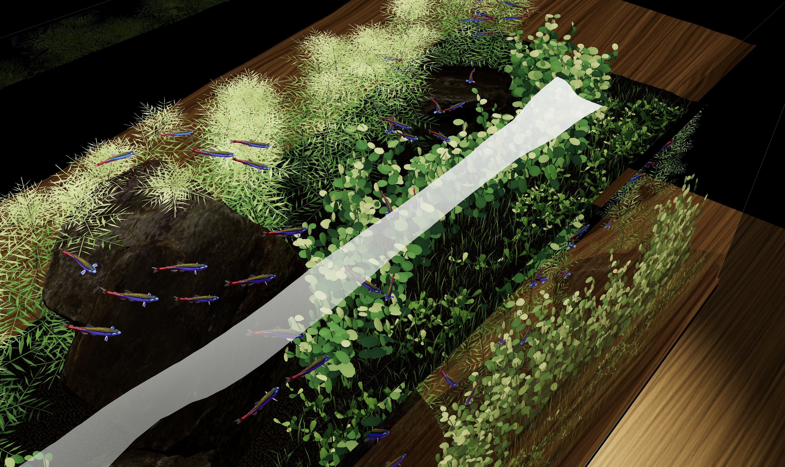
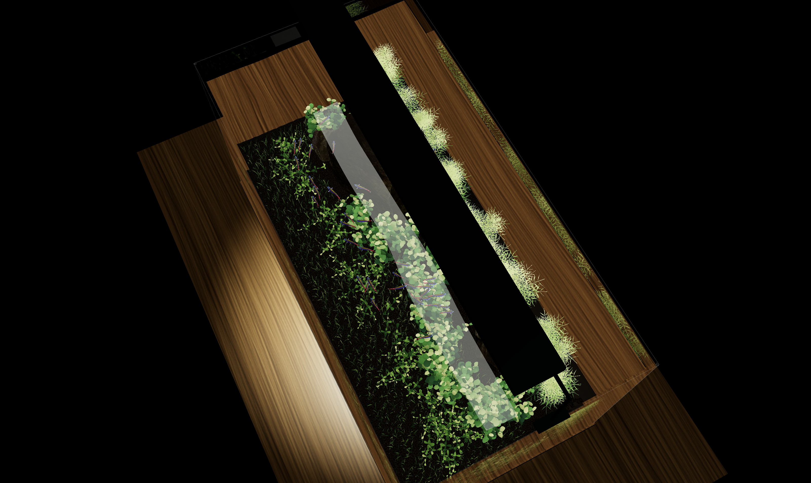

# Stillwater Aquarium

[简体中文](README.md) · **English**

An interactive Three.js aquarium with water refraction, schooling fish, and procedural aquatic plants.

[](https://github.com/Candela683/stillwater-aquarium/releases/latest/download/aquarium-demo-4k.mp4)

[4K demo](https://github.com/Candela683/stillwater-aquarium/releases/latest/download/aquarium-demo-4k.mp4) · [1080p demo](https://github.com/Candela683/stillwater-aquarium/raw/refs/heads/main/docs/media/aquarium-demo.mp4) · [Front view](docs/media/aquarium-front.png)

## Screenshots

**Aquascape**

[](docs/media/aquarium-overview.png)

**Front close-up**

[](docs/media/aquarium-front.png)

**Rear view**

[](docs/media/aquarium-rear.png)

**Side view**

[](docs/media/aquarium-side.png)

**Surface refraction**

[](docs/media/aquarium-surface.png)

**Surface close-up**

[](docs/media/aquarium-surface-detail.png)

**Top view**

[](docs/media/aquarium-top.png)

## Features

- **Water and glass**: BVH ray intersections provide reflection, refraction, Fresnel effects, and total internal reflection. A heightfield simulation produces continuous surface ripples.
- **Schooling behavior**: Neon tetras form dynamic schools through separation, alignment, cohesion, and predictive obstacle avoidance, with random grouping, darting, gliding, and responses to clicks.
- **Fish animation**: Skeletal poses and body bending drive swimming motion. Iridescent materials change with the viewing angle.
- **Procedural plants**: Hairgrass, tall and dwarf pearl plants, and ambulia use parametric leaf surfaces and curved stems, with variation in leaf shape, size, orientation, and color.
- **Water interaction**: Fish wakes affect nearby plants, producing local movement through continuous leaf bending.

## Run locally

Requires Node.js 22.12+ and a browser with WebGL 2 support.

```sh
npm ci
npm run dev
```

Open <http://127.0.0.1:5179/>.

```sh
npm test        # Run tests
npm run build   # Build to dist/
npm run preview # Preview the build
```

## Controls

| Input | Action |
| --- | --- |
| Drag | Orbit the camera |
| Scroll / pinch | Adjust viewing distance |
| Click near the fish | Trigger a local startle response and surface ripples |
| `1` / `2` / `3` | Switch to aquascape, fish, or plant close-ups |
| `S` | Save a 3840 × 2160 PNG screenshot |
| `R` | Export a 24-second 1080p demo video |

## Project structure

```text
src/
  aquascape.js      Scene and animation loop
  ray-water.js      Ray intersections, glass, and water shading
  schooling.js      Schooling, grouping, and obstacle avoidance
  fish-darts.js     Darting and click responses
  tetra-model.js    Fish model, pose cache, and materials
  ambulia-plants.js Ambulia stems and leaf whorls
  pearl-plants.js   Pearl plant growth and leaf surfaces
  vegetation.js     Plant placement and hairgrass
  leaf-flex.js      Continuous leaf bending
  capture.js        Screenshot and video export
public/models/     Models, textures, and attribution
tests/             Automated tests
docs/media/        Screenshots and demo videos
```

## Credits and licenses

Project code is licensed under [MIT](LICENSE). Third-party assets retain their respective licenses.

- [WebGL Water — Evan Wallace](https://madebyevan.com/webgl-water/): MIT. Reference for water simulation and optical algorithms.
- [Neon Tetra Automated Swimming Rig — AeroPlankton](https://sketchfab.com/3d-models/neon-tetra-automated-swimming-rig-22cddb626d9f417e9baec7894e86cb73): CC BY 4.0. Modified axes, scale, swimming deformation, and materials.
- [Rock 07 — Jenelle van Heerden / Poly Haven](https://polyhaven.com/a/rock_07): CC0. Simplified geometry, adjusted scale, and tint.

See [THIRD_PARTY_NOTICES.md](THIRD_PARTY_NOTICES.md) for detailed attribution and licenses.
