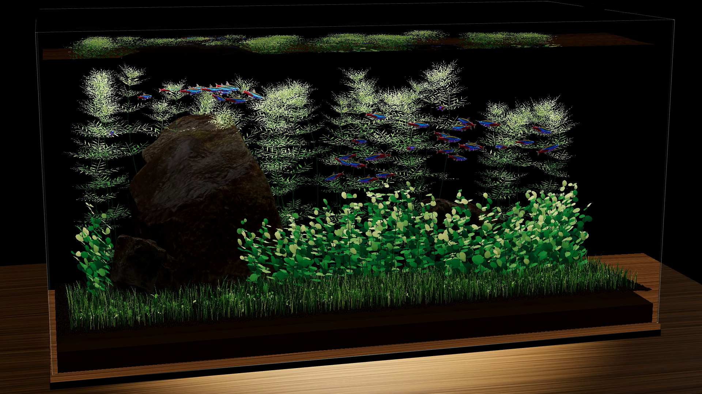
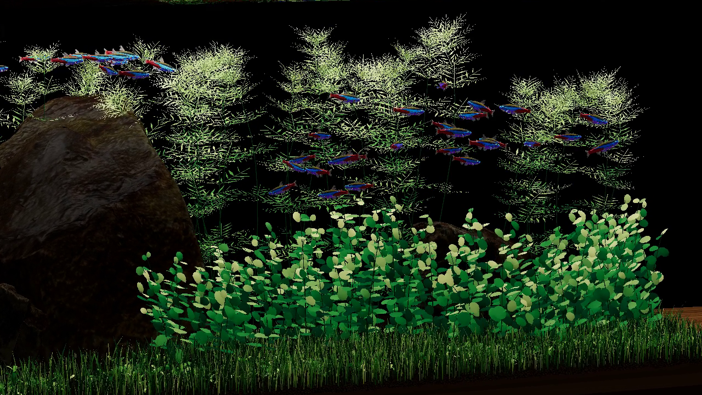
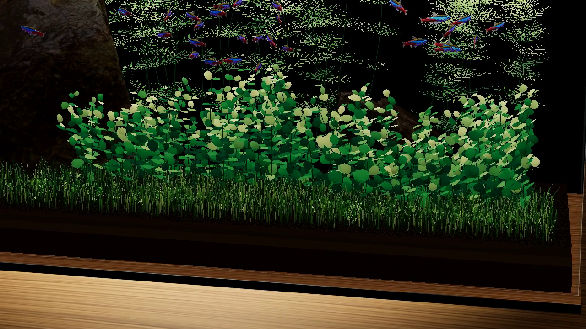

# Stillwater Aquarium · 静水鱼缸

基于 Three.js 的交互式水族箱，包含水体折射、鱼群行为模拟和程序化水草。

[](https://github.com/Candela683/stillwater-aquarium/releases/latest/download/aquarium-demo-4k.mp4)

[4K 演示](https://github.com/Candela683/stillwater-aquarium/releases/latest/download/aquarium-demo-4k.mp4) · [1080p 演示](https://github.com/Candela683/stillwater-aquarium/raw/refs/heads/main/docs/media/aquarium-demo.mp4) · [正面截图](docs/media/aquarium-front.png)

## 高清截图

**水草造景**

[](docs/media/aquarium-detail-aquascape.png)

**霓虹灯鱼与宝塔草**

[](docs/media/aquarium-detail-school.png)

**珍珠草与牛毛草**

[](docs/media/aquarium-detail-plants.png)

<details>
<summary>全景视角</summary>


</details>

## 功能

- **水体与玻璃**：基于 BVH 光线求交实现反射、折射、菲涅耳效应与全内反射，高度场模拟持续的水面涟漪。
- **鱼群行为**：霓虹灯鱼通过分离、对齐、聚合与预测避障形成动态鱼群，支持随机分群、冲刺、滑行和点击惊吓。
- **鱼体动画**：骨骼姿态与身体弯曲驱动游动，虹彩材质随观察角度变化。
- **程序化水草**：牛毛草、高低珍珠与宝塔草采用参数化叶面和曲线茎秆，叶形、大小、朝向及颜色具有随机变化。
- **水流交互**：鱼群尾流影响附近水草，连续弯曲模型产生局部摆动。

## 本地运行

需要 Node.js 22.12+ 和支持 WebGL 2 的浏览器。

```sh
npm ci
npm run dev
```

打开 <http://127.0.0.1:5179/>。

```sh
npm test        # 运行测试
npm run build   # 构建到 dist/
npm run preview # 预览构建结果
```

## 操作

| 操作 | 功能 |
| --- | --- |
| 拖动 | 环绕观察 |
| 滚轮 / 双指缩放 | 调整观察距离 |
| 点击鱼群附近 | 触发局部惊吓与水面扰动 |
| `S` | 保存 PNG 截图 |
| `R` | 导出 24 秒的 1080p 演示视频 |

## 代码结构

```text
src/
  aquascape.js       场景与主循环
  ray-water.js       光线求交、玻璃和水面着色
  schooling.js      群游、分组与避障
  fish-darts.js     冲刺与点击惊吓
  tetra-model.js    鱼模型、姿态缓存与材质
  ambulia-plants.js 宝塔草茎秆与轮生叶
  pearl-plants.js   珍珠草生长参数与叶面
  vegetation.js     水草布置与牛毛草
  leaf-flex.js      连续叶片弯曲
  capture.js        截图与视频导出
public/models/      模型、贴图与授权说明
tests/              自动化测试
docs/media/         截图与演示视频
```

## 素材与许可

项目代码采用 [MIT 许可](LICENSE)，第三方素材遵循各自许可。

- [WebGL Water — Evan Wallace](https://madebyevan.com/webgl-water/)：MIT，水面模拟与光学算法参考。
- [Neon Tetra Automated Swimming Rig — AeroPlankton](https://sketchfab.com/3d-models/neon-tetra-automated-swimming-rig-22cddb626d9f417e9baec7894e86cb73)：CC BY 4.0，已调整轴向、缩放、游动形变与材质。
- [Rock 07 — Jenelle van Heerden / Poly Haven](https://polyhaven.com/a/rock_07)：CC0，已简化几何、缩放并调整色调。

详细署名与许可见 [THIRD_PARTY_NOTICES.md](THIRD_PARTY_NOTICES.md)。
